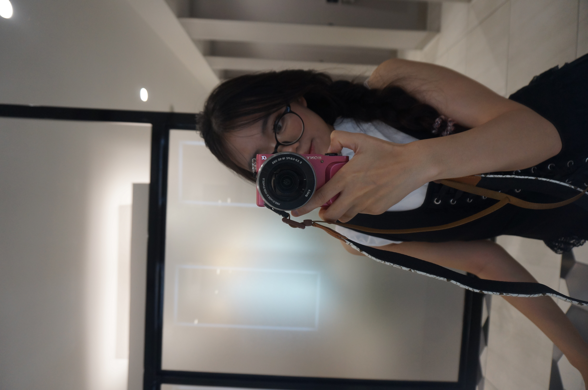

# gioi-thieu-ban-than
# tôi là Nguyễn Đan Giang
# ảnh đại diện

Xin chào! Tôi là sinh viên chuyên ngành Sư phạm Tin học tại Trường Đại học Sư phạm, Đại học Huế. Hiện tại, ngoài thời gian học thuật tập trung vào lập trình và cấu trúc dữ liệu, tôi cũng đang làm gia sư bán thời gian ngay tại Huế.

## Sở thích cá nhân
* Chăm sóc thú cưng, đặc biệt là hai bé Sóc bay Úc (Sugar Glider) của tôi.
* Chơi cầu lông cùng bạn bè tại trung tâm văn hóa thể thao vài ngày trong tuần.
* Nghiên cứu cấu trúc dữ liệu, thuật toán và ngôn ngữ lập trình Python.
* Chụp ảnh bằng máy ảnh không gương lật và chăm sóc các loại cây trong nhà như Nhất Mạt Hương hay Tùng Thơm.

## Thông tin liên hệ
* **Email:** [nguyendangiang29032007@gmail.com](mailto:nguyendangiang29032007@gmail.com)
* **Facebook:** [https://www.facebook.com/nguyen.giang.432963/]
> "Học, học nữa, học mãi." - V.I. Lenin

